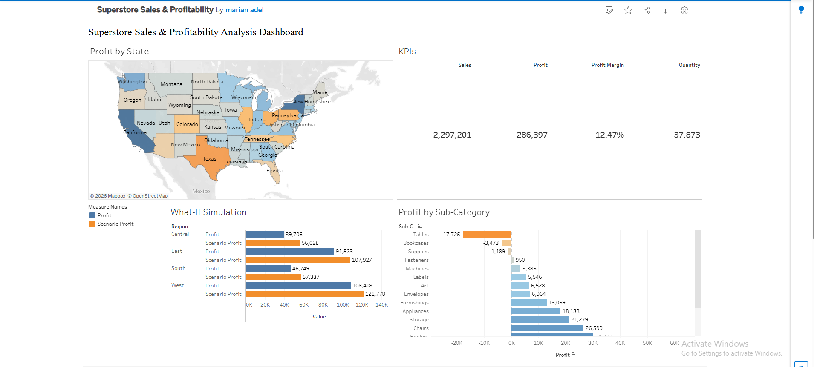

# Superstore Sales & Profitability Analysis Dashboard

## 🎯 نظرة عامة على المشروع (Project Overview)
يهدف هذا المشروع إلى تحليل مبيعات وأرباح متجر Superstore عبر الولايات المتحدة، وتحديد المنتجات والولايات التي تحقق خسائر، بالإضافة إلى محاكاة تأثير تقليل نسب الخصومات على صافي الأرباح (What-If Simulation).

## 🛠️ الأدوات المستخدمة (Tools & Technologies)
* **Microsoft Excel:** تنظيف البيانات، وبناء نموذج النجمة (Star Schema) باستخدام Power Query وPower Pivot، وحساب مقاييس الأداء عبر معادلات DAX.
* **Tableau Public:** تصميم لوحة معلومات تفاعلية لعرض المؤشرات الرئيسية، وتحليل الخرائط الجغرافية، ومحاكاة السيناريوهات المالية.

## 📊 أهم النتائج والتوصيات (Key Insights)
* **إجمالي المبيعات والأرباح:** حققت الشركة مبيعات بقيمة **2,297,201$** وصافي ربح **286,397$** بهامش ربح إجمالي **12.47%** لإجمالي **37,873** قطعة مباعة.
* **الفئات الخاسرة:** تتسبب فئة الطاولات (**Tables**) في أكبر خسارة للشركة بقيمة **-17,725$**، تليها خزائن الكتب (**Bookcases**) بقيمة **-3,473$** نتيجة الخصومات المرتفعة.
* **تأثير تحسين الخصومات (What-If Analysis):** أظهرت المحاكاة أن تقليل نسب الخصم الحالية بنسبة 10% يرفع صافي الأرباح بشكل ملحوظ في جميع المناطق، خاصة في منطقتي الغرب (West) والشرق (East).

## 🔗 رابط لوحة المعلومات التفاعلية (Live Dashboard)
* [اضغط هنا لتجربة اللوحة التفاعلية على Tableau Public](https://public.tableau.com:9443/views/SuperstoreSalesProfitability_17948322083570/Dashboard1?:language=en-US&publish=yes&:sid=&:redirect=auth&:display_count=n&:origin=viz_share_link)

## 📸 معاينة لوحة المعلومات (Dashboard Preview)

